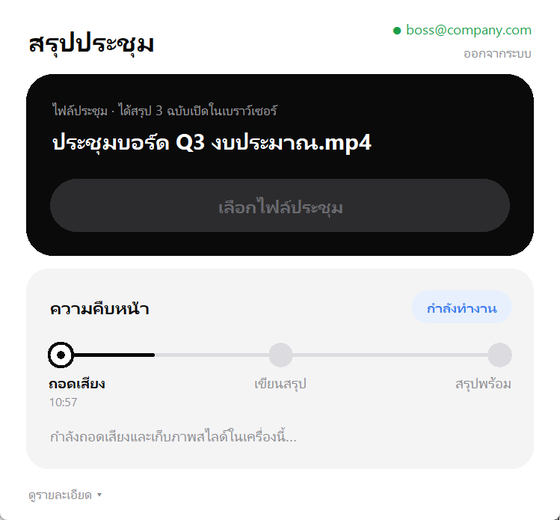
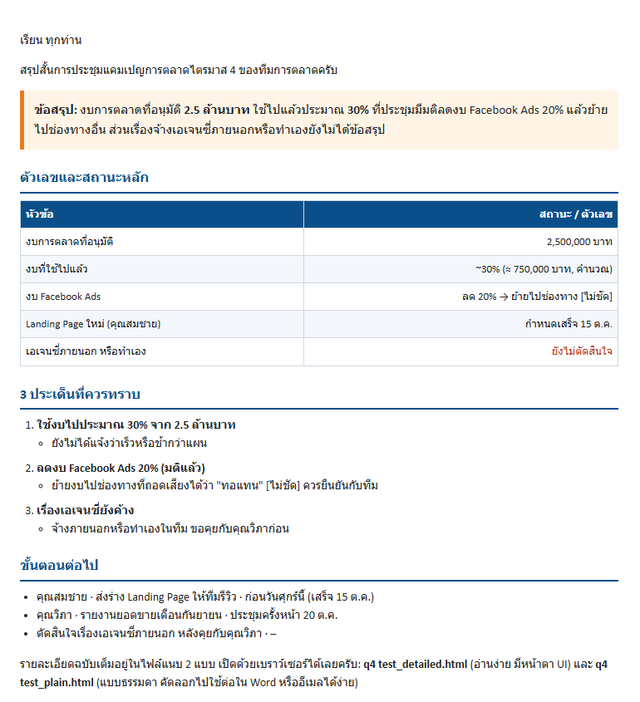
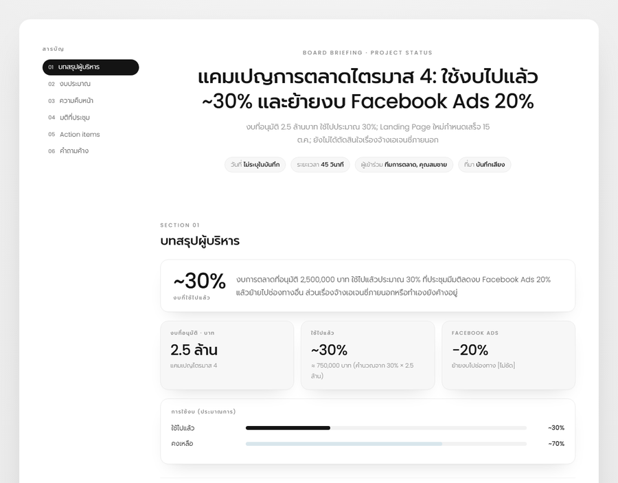
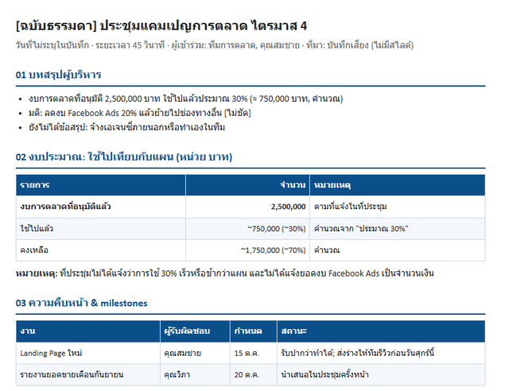
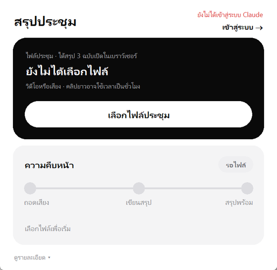

# สรุปประชุม

**เลือกไฟล์คลิปประชุม → รอ → ได้สรุปประชุม 3 แบบ เปิดอ่านในเบราว์เซอร์ได้ทันที**

ไม่ต้องพิมพ์คำสั่ง ไม่ต้องรู้เรื่องคอมพิวเตอร์ แค่กดปุ่ม

---

## ✅ ก่อนเริ่ม ต้องมีอะไรบ้าง

| | สิ่งที่ต้องมี | หมายเหตุ |
|---|---|---|
| 💻 | คอมพิวเตอร์ **Windows 10 หรือ 11** | Mac ยังใช้ไม่ได้ |
| 🔑 | **บัญชี Claude แบบเสียเงิน** (Pro, Max, Team หรือ Enterprise) | บัญชีฟรีใช้ไม่ได้ |
| 🌐 | อินเทอร์เน็ต | ครั้งแรกต้องดาวน์โหลดประมาณ 3–4 GB |
| 💾 | พื้นที่ว่างในเครื่องอย่างน้อย **10 GB** | |

### ต้อง login อะไรบ้าง?

| | ต้อง login ไหม |
|---|---|
| **Claude** | ✅ **ครั้งเดียวตอนติดตั้ง** แล้วเครื่องจะจำไว้ ปิดเครื่องแล้วเปิดใหม่ก็ไม่ต้อง login ซ้ำ |
| GitHub (หน้าเว็บนี้) | ❌ ไม่ต้อง ไม่ต้องสมัครสมาชิก |
| Windows | ⚠️ ไม่ต้องใส่รหัส แต่อาจมีหน้าต่างถามว่า "อนุญาตไหม" ให้กด **Yes** |

---

## 📥 ติดตั้ง (ทำครั้งเดียว ประมาณ 15–40 นาที)

**1. ดาวน์โหลด**
กดปุ่มสีเขียว **`<> Code`** ด้านบนหน้านี้ → กด **Download ZIP**

**2. แตกไฟล์**
ไปที่โฟลเดอร์ Downloads → คลิกขวาที่ไฟล์ `meeting-summary-main.zip` → เลือก **Extract All…** → กด **Extract**
> ⚠️ ต้องแตกไฟล์ก่อน ห้ามดับเบิลคลิกเปิดจากใน ZIP ตรงๆ

**3. เริ่มติดตั้ง**
ในโฟลเดอร์ที่แตกออกมา ดับเบิลคลิกไฟล์ **`Install.bat`**
จะมีหน้าต่างสีดำขึ้นมา บอกความคืบหน้าทีละขั้น (1/6 ถึง 6/6) ระหว่างนั้นอาจเจอ:

| ถ้าเห็น… | ให้กด… |
|---|---|
| หน้าต่างสีฟ้า **"Windows protected your PC"** | **More info** → **Run anyway** |
| หน้าต่างถาม **"Do you want to allow this app to make changes…"** | **Yes** |
| **เบราว์เซอร์เปิดหน้า Claude** ขึ้นมาเอง (ขั้น 5/6) | login ด้วยบัญชี Claude → กด **Authorize** → กลับมาที่หน้าต่างสีดำ |

**4. เสร็จแล้ว**
หน้าต่างสีดำจะขึ้นตัวเขียว **"ติดตั้งเสร็จแล้ว"** กดปุ่มอะไรก็ได้เพื่อปิด
บน Desktop จะมีไอคอน **สรุปประชุม** เพิ่มขึ้นมา 🎉

> 💡 ถ้าเน็ตหลุดหรือติดตั้งไม่ผ่าน ไม่ต้องกังวล ดับเบิลคลิก `Install.bat` ใหม่ได้เลย ขั้นที่ทำเสร็จแล้วจะถูกข้าม ไม่ต้องโหลดใหม่ทั้งหมด

---

## ▶️ วิธีใช้

**1.** ดับเบิลคลิกไอคอน **สรุปประชุม** บน Desktop
**2.** กดปุ่มขาว **เลือกไฟล์ประชุม** → เลือกไฟล์คลิป (วิดีโอหรือเสียงก็ได้ เช่น `.mp4` `.mp3` `.m4a` `.wav`)
  หรือจะลากไฟล์คลิปไปวางบนไอคอน **สรุปประชุม** เลยก็ได้

**3.** รอ โปรแกรมจะทำงานเอง 3 ขั้น ดูความคืบหน้าได้จากเส้นสีดำ

| ขั้น | ทำอะไร | ใช้เวลาประมาณ |
|---|---|---|
| ถอดเสียง | แปลงเสียงในคลิปเป็นข้อความ ทำในเครื่องนี้ | คลิป 1 ชั่วโมง ใช้ 15–60 นาที ขึ้นกับเครื่อง |
| เขียนสรุป | Claude อ่านแล้วเขียนสรุป | 5–15 นาที |
| สรุปพร้อม | เสร็จ ✓ | |

> 💡 ระหว่างรอใช้คอมทำงานอื่นได้ แค่อย่าปิดหน้าต่างโปรแกรม

**4.** เสร็จแล้วจะมีรายการ 3 ฉบับ **กดแถวไหนก็ได้ จะเปิดในเบราว์เซอร์ทันที**
จะอ่าน ก๊อปข้อความ หรือพิมพ์ ก็ทำในเบราว์เซอร์ได้เลย

---

## 📄 ผลลัพธ์ที่ได้ (ตัวอย่างจากประชุมทดสอบ)

### 1) สรุปผู้บริหาร: อ่านจบใน 3 นาที
ข้อสรุป ตัวเลขสำคัญ และสิ่งที่ต้องทำต่อ

### 2) รายงานฉบับเต็ม: ทุกหัวข้อ พร้อมภาพสไลด์
หน้าตาสวย มีสารบัญ ตัวเลขเด่น และภาพสไลด์จากคลิป (ถ้าคลิปมีสไลด์)

### 3) ฉบับข้อความล้วน: ก๊อปไปใช้ต่อได้ทันที
ไม่มีดีไซน์ กด Ctrl+A → Ctrl+C แล้วไปวางใน Word หรืออีเมลได้เลย

ไฟล์ทั้ง 3 ฉบับเก็บไว้ในโฟลเดอร์เดียวกับคลิป กด **แสดงในโฟลเดอร์** มุมขวาล่างของโปรแกรมเพื่อเปิดดู

---

## 🔑 เข้าสู่ระบบ / ออกจากระบบ Claude

มุมขวาบนของโปรแกรมบอกสถานะบัญชี Claude ตลอด

- **● อีเมลสีเขียว** = เข้าสู่ระบบอยู่ ใช้งานได้เลย มีปุ่ม **ออกจากระบบ** ใต้อีเมล
- **ตัวแดง "ยังไม่ได้เข้าสู่ระบบ Claude"** = กด **เข้าสู่ระบบ →** แล้ว login ในเบราว์เซอร์ที่เปิดขึ้นมา

---

## 🆘 เจอปัญหา?

| อาการ | วิธีแก้ |
|---|---|
| ติดตั้งค้าง / เน็ตหลุด / ขึ้นตัวแดงตอนติดตั้ง | ดับเบิลคลิก `Install.bat` ใหม่อีกครั้ง |
| มุมขวาบนขึ้นตัวแดง "ยังไม่ได้เข้าสู่ระบบ" | กด **เข้าสู่ระบบ →** |
| ขึ้นป้ายแดง **ไม่สำเร็จ** | อ่านข้อความสีแดงในการ์ด ถ้ายังไม่หาย กด **ดูรายละเอียด** แล้วแคปหน้าจอส่งให้ผู้ดูแล |
| ช้ามาก | ปกติสำหรับคลิปยาวบนโน้ตบุ๊กที่ไม่มีการ์ดจอแยก ปล่อยไว้ได้เลย |
| ไม่เห็นไอคอนบน Desktop | ติดตั้งยังไม่จบ ดับเบิลคลิก `Install.bat` ใหม่ |

## 🔒 ข้อมูลไปไหนบ้าง

- **เสียงและวิดีโอ:** ไม่ออกจากเครื่อง ถอดเสียงในเครื่องนี้
- **ข้อความที่ถอดได้:** ส่งให้ Claude (บัญชีของคุณเอง) เพื่อเขียนสรุป
- **ไฟล์สรุป:** เก็บในเครื่อง โฟลเดอร์เดียวกับคลิป

## 🔄 เวอร์ชัน และการอัปเดต

**เวอร์ชันล่าสุด: 1.0.0** (15 ต.ค. 2026)

ดูว่าเครื่องคุณใช้เวอร์ชันไหนได้ที่**มุมขวาล่างของโปรแกรม** (เช่น `v1.0.0`) ถ้าเลขในโปรแกรมต่ำกว่าเวอร์ชันล่าสุดในหน้านี้ แปลว่ามีของใหม่ให้อัปเดต

**วิธีอัปเดต** (ประมาณ 2–5 นาที ไม่ต้องโหลดโมเดลซ้ำ และไม่ต้อง login ใหม่)
1. ดาวน์โหลด ZIP ใหม่จากหน้านี้ แล้วแตกไฟล์ (เหมือนตอนติดตั้งครั้งแรก)
2. ดับเบิลคลิก `Install.bat` ในโฟลเดอร์ใหม่
3. เปิดโปรแกรม แล้วดูมุมขวาล่างว่าเลขเวอร์ชันเปลี่ยนแล้ว

### มีอะไรใหม่ในแต่ละเวอร์ชัน

| เวอร์ชัน | วันที่ | มีอะไรใหม่ |
|---|---|---|
| **1.0.0** | 15 ต.ค. 2026 | เวอร์ชันแรก: ติดตั้งด้วย Install.bat, หน้าโปรแกรมแบบใหม่, ได้สรุป 3 ฉบับเปิดในเบราว์เซอร์, ปุ่มเข้าสู่ระบบ / ออกจากระบบ Claude |

---

<b>สำหรับผู้ดูแล (technical)</b>

- `skill/` = Claude Code skill (`SKILL.md`, `transcribe.py`, `frames.py`, `make_email.py`, templates) + `app.py` (หน้าต่าง Tk) + `icon.ico`
- `install.ps1` ติดตั้งลง `%USERPROFILE%\.claude\skills\meeting-summary`: uv + Python 3.12 venv, โมเดล, Git (winget), Claude Code + `claude auth login`, shortcut บน Desktop
- Login: `claude auth login` เก็บ credential ใน `%USERPROFILE%\.claude` (คงอยู่ข้ามการรีสตาร์ท); แอปเช็กด้วย `claude auth status` และมีปุ่ม login / logout
- ผลลัพธ์: `<ชื่อคลิป>_executive.html`, `_detailed.html`, `_plain.html` (+ `_executive.eml`) ในโฟลเดอร์เดียวกับคลิป
- โมเดล: Whisper large-v3-turbo จาก [deepdml/faster-whisper-large-v3-turbo-ct2](https://huggingface.co/deepdml/faster-whisper-large-v3-turbo-ct2); Typhoon จาก Release `models-v1` ของ repo นี้ (CTranslate2 float16 ของ [typhoon-ai/typhoon-whisper-turbo](https://huggingface.co/typhoon-ai/typhoon-whisper-turbo), MIT)
- เครื่องที่มี NVIDIA GPU ใช้ CUDA อัตโนมัติ; Intel GPU (OpenVINO) ต้องวางโมเดล `*-ov` เพิ่มเอง ไม่งั้นใช้ CPU
- ออกเวอร์ชันใหม่: แก้ไฟล์ใน `skill/` → เพิ่ม `APP_VERSION` ใน `skill/app.py` (MAJOR.MINOR.PATCH: แก้บั๊ก = PATCH, เพิ่มความสามารถ = MINOR, เปลี่ยนใหญ่/ต้องติดตั้งใหม่ทั้งหมด = MAJOR) → เพิ่มแถวในตาราง "มีอะไรใหม่" และแก้ "เวอร์ชันล่าสุด" → commit, `git tag vX.Y.Z`, push พร้อม tag
- รูปใน `docs/images/` มาจากประชุมทดสอบที่สมมติขึ้น และใช้อีเมลตัวอย่าง

